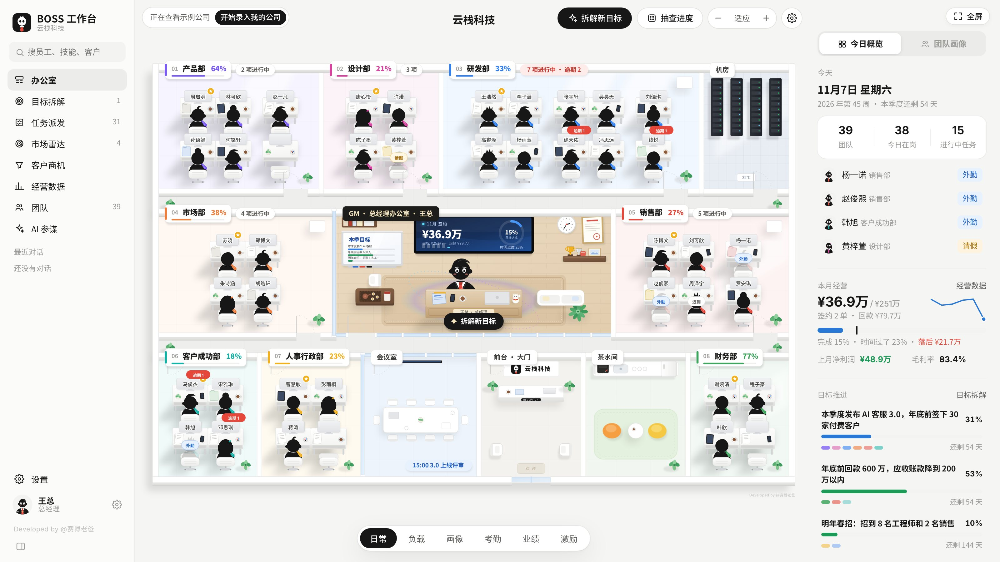
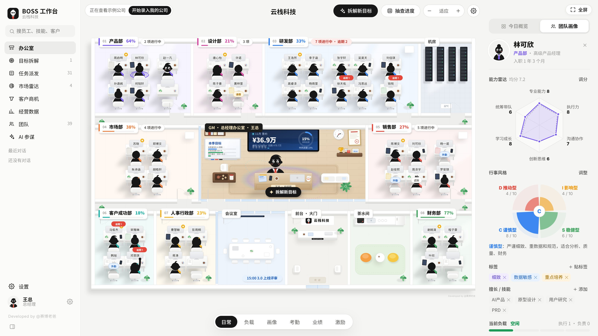
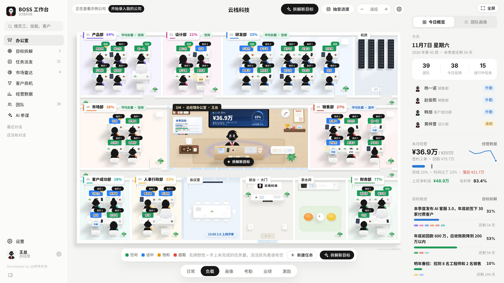
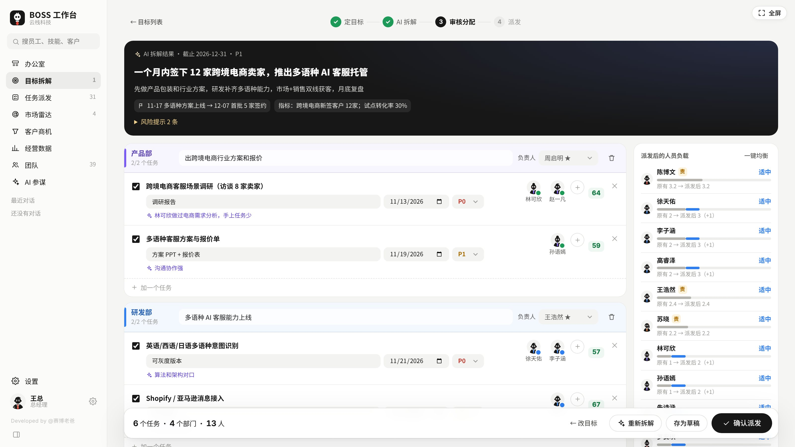
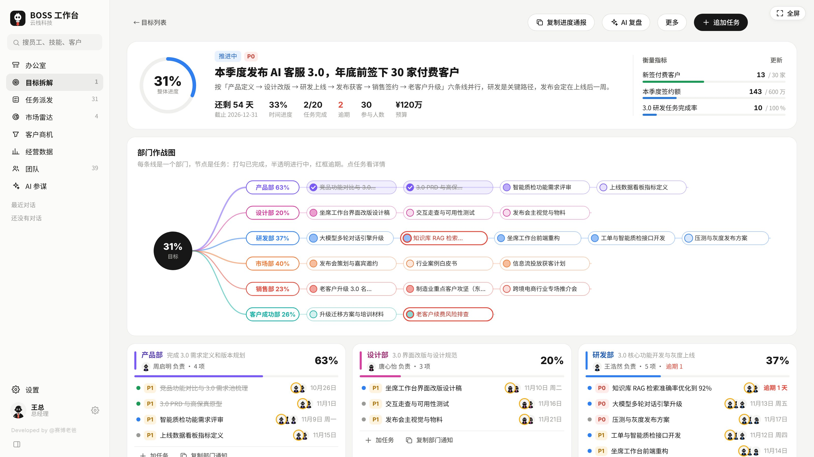
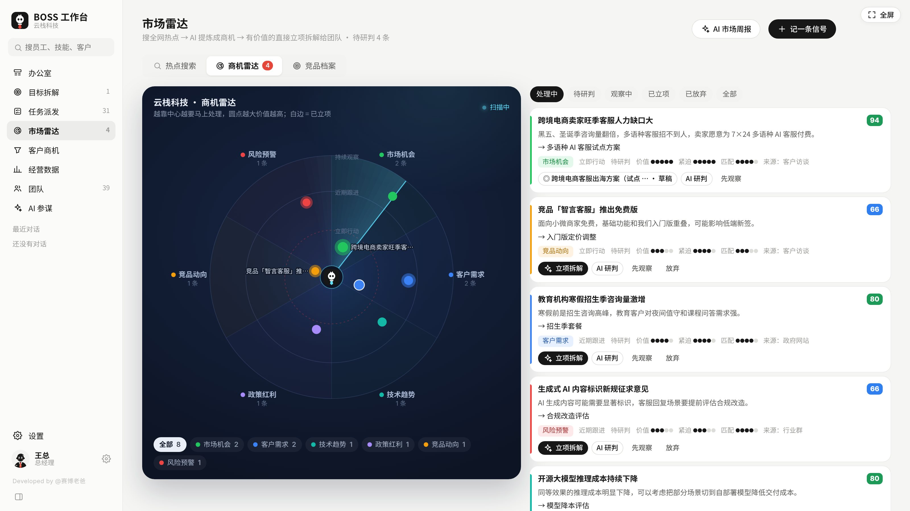
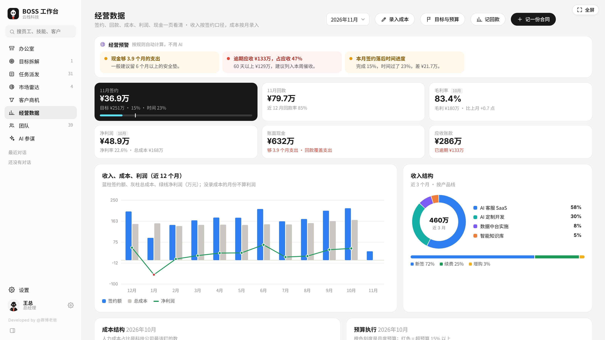
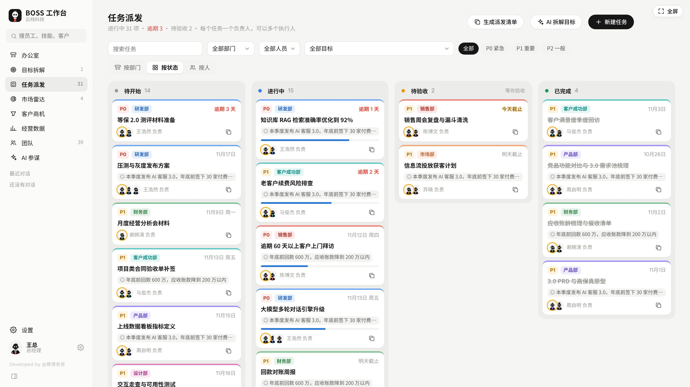

# BOSS 工作台

> 个人工作台系列 · 第 8 期 · v2.0.0 · 给公司老板和个体工商户用的经营工作台

一个 HTML 文件，双击就能用。基础功能**不用安装、不用注册、不用服务器**，没有需要下载的运行时依赖或 CDN 资源；业务数据保存在当前浏览器的本地存储中。使用 AI 时，相关问题和上下文会发送到你配置的 AI 接口。

**仓库：** [cyberdaddyleo/workstation-BOSS](https://github.com/cyberdaddyleo/workstation-BOSS) · [下载与第一次使用](docs/GETTING_STARTED.md) · [填写自己的资料、AI 与备份](docs/CONFIGURATION.md)

- 一张总部平面图看全公司：谁在岗、谁手上活多、哪个部门进度落后
- 给每个员工建画像：能力雷达、行事风格、标签、备注，派活时知人善任
- 老板一句话下目标，**AI 拆给各部门**，推荐负责人和执行人，你确认后一键派发
- 市场雷达通过配置的 AI 联网接口搜索热点，提炼商机，有价值的直接立项
- 经营数据看清签约、回款、利润、现金，**AI 做经营诊断**并给出建议



---

## 目录

- [快速开始](#快速开始)
- [功能截图](#功能截图)
- [使用指南](#使用指南)
  - [办公室（总部平面图）](#1-办公室总部平面图)
  - [团队画像](#2-团队画像)
  - [目标拆解（核心功能）](#3-目标拆解核心功能)
  - [任务派发](#4-任务派发)
  - [市场雷达](#5-市场雷达)
  - [客户商机](#6-客户商机)
  - [经营数据](#7-经营数据)
  - [AI 参谋](#8-ai-参谋)
  - [团队](#9-团队)
- [配置 AI](#配置-ai)
- [数据与备份](#数据与备份)
- [仓库结构](#仓库结构)
- [常见问题](#常见问题)
- [开源版与商用版](#开源版与商用版)
- [开源协议](#开源协议)

---

## 快速开始

1. 在[仓库页面](https://github.com/cyberdaddyleo/workstation-BOSS)点击绿色 **Code → Download ZIP**，下载后解压。
2. 用 **Chrome** 或 **Edge** 浏览器打开 `index.html`（双击即可）。
3. 第一次打开会看到欢迎页，二选一：
   - **先看看示例公司**：载入「云栈科技」（8 个部门、39 人），附有目标、任务、客户和经营记录，适合先体验；
   - **直接用我的公司**：填你的称呼、职位、公司 / 店铺名称和行业，选择科技公司、一般公司、个体户 / 门店、工作室 / 小团队中的一个部门模板，从空白业务数据开始。
4. 示例公司看完后，点办公室左上角「**开始录入我的公司**」，填资料并点「清空并开始」。这会清除示例业务数据，保留老板形象和 AI 设置；已有需要保留的数据时先导出备份。

也可以用 Git 获取：

```bash
git clone --branch main https://github.com/cyberdaddyleo/workstation-BOSS.git
cd workstation-BOSS
```

打开目录里的 `index.html` 即可，**不需要 `npm install` 或启动开发服务器**。想让 AI 助手帮你下载和打开，可复制[快速上手中的完整指令](docs/GETTING_STARTED.md#让-ai-助手帮你获取和打开)。

自己的姓名 / 称呼、职位在「**设置 → 老板形象**」修改；公司名称、行业、城市等在「**设置 → 公司信息**」修改，均会自动保存。员工资料在「团队」中编辑，不需要改源代码。详见[配置指南](docs/CONFIGURATION.md)。

**运行环境**

| 项目 | 要求 |
|---|---|
| 设备 | 电脑（Windows / Mac），开源版只做了 PC 端 |
| 浏览器 | Chrome、Edge 最新版（推荐） |
| 屏幕 | 宽度 1280 以上效果最好 |
| 网络 | 平时不需要联网；用 AI 功能时需要能访问你选的 AI 服务商 |

---

## 功能截图

| 团队画像 | 负载视图 |
|---|---|
|  |  |

| AI 拆解目标 | 目标作战图 |
|---|---|
|  |  |

| 市场雷达 | 经营数据 |
|---|---|
|  |  |



---

## 使用指南

左侧菜单从上到下：办公室、目标拆解、任务派发、市场雷达、客户商机、经营数据、团队、AI 参谋，最下面是设置。

### 1. 办公室（总部平面图）

打开就是公司总部的平面图：同一个部门的人坐在一起，每个部门系不同颜色的领带，正中间是总经理办公室。

**看什么**

- 部门牌：部门名、目标完成度、进行中的任务数，有逾期会标红。
- 工位：员工名牌、外勤 / 请假 / 迟到标记、任务逾期提醒。
- 总经理办公室：大屏显示本月签约和完成率，白板显示本季目标进度。

**底部 6 个模式**

| 模式 | 用来做什么 |
|---|---|
| 日常 | 默认视图，看在岗情况和逾期提醒 |
| 负载 | 名牌颜色表示手上未完成的任务量（空闲 / 适中 / 饱和 / 超载），派活前先看谁有空 |
| 画像 | 每个人桌上显示主要标签，颜色代表行事风格 |
| 考勤 | 点员工切换 在岗 → 外勤 → 请假 → 缺勤 → 迟到，可选日期、导出本月考勤 |
| 业绩 | 销售看签约额（绿标 = 达成个人目标），其他岗位看完成任务数 |
| 激励 | 点员工选择表扬或提醒的理由，积分记进团队档案 |

**常用操作**

- 点员工：右栏切到「团队画像」，查看和修改这个人的资料。
- 点部门牌：查看部门画像（部门能力均值、成员负载），可以换部门负责人、给部门派任务。
- 点空工位：添加员工。
- 顶部「**拆解新目标**」：进入目标拆解；「**抽查进度**」：随机抽一个人看他手上的任务。
- 顶部的「− 适应 +」可以缩放平面图，右上角可以全屏；齿轮按钮打开办公室设置，可以改公司名称、管理部门（新增、删除、改颜色、调整顺序）。
- 右栏顶部可以在「**今日概览**」和「**团队画像**」之间切换。今日概览里有今日在岗、本月经营、目标推进、任务预警。

### 2. 团队画像

在办公室点任意员工，右栏显示他的画像，派活前用来判断谁合适：

- **能力雷达**：专业能力、执行力、沟通协作、创新思维、学习成长、统筹带队 6 项，每项 1–10 分，点「调分」拖动修改。
- **行事风格**：推动型 / 影响型 / 稳健型 / 谨慎型 四色图，点「调整」修改，下方有一句话说明这个人适合做什么。
- **标签**：性格、工作风格、状态三类常用标签一点就贴，也可以自定义。
- **擅长 / 技能**：比如「跨境电商」「数据分析」，AI 拆解派活时会优先匹配。
- **当前负载**：手上执行、负责的任务数和负载等级。
- **备注**：记在本地档案中，比如「适合对外、不太爱主动汇报」。使用相关 AI 功能时，备注可能作为上下文发送给配置的接口。

> 画像、技能和备注为 AI 分工提供参考；没填也能用，系统会参考岗位和负载。推荐结果仍需你审核。

### 3. 目标拆解（核心功能）

老板只管说目标，工作台帮你拆到部门、拆到人。整个流程分 4 步：

**第 1 步 · 定目标**
一句话写目标，比如「一个月内签下 12 家跨境电商卖家，推出多语种 AI 客服托管」。可选补充：背景 / 要求、截止日期、预算、优先级、参与部门（不选就由 AI 判断需要哪些部门）、拆多细（每个部门 2–3 项 / 3–5 项 / 5–7 项）、谁来定人（默认 AI 推荐负责人和执行人，也可以按能力分自动匹配）。

**第 2 步 · 拆解**，三种方式任选：

- **AI 拆解**（需要配置 AI）：自动拆出各部门的分目标、任务、交付物、截止日、优先级，并按能力、技能、负载推荐负责人和执行人，每个推荐都附一句理由；同时给出关键指标、里程碑和风险提示。
- **按模板拆**：不用 AI，按常见的部门分工生成一份基础方案，自己再改。
- **复制提示词**：没配置 AI 时也能用。复制提示词到豆包、DeepSeek 等网页版，再点「粘贴 AI 结果」贴回来即可。

**第 3 步 · 审核分配**

- 每个部门可以改分目标、换**负责人**；
- 每个任务可以改标题、交付物、日期、优先级，加人或换**执行人**。候选人按匹配度排序，能看到每个人当前的负载；
- 右侧实时显示「**派发后的人员负载**」，有人超载时点「**一键均衡**」；
- 不满意可以「重新拆解」，或者先「存为草稿」。

**第 4 步 · 派发**
点「确认派发」后任务进入各部门，并生成各部门的派活通知，可以按部门复制，也可以「复制全部通知」发到工作群。办公室里接到新任务的人会亮一下。

派发后在「目标拆解」里打开目标，可以看到：
- **作战图**：每个部门一条线，每个任务一个节点，完成、进行中、逾期一眼看清；
- **甘特图**：按时间排开所有任务；
- 关键指标进度、里程碑、风险，随时可以修改。

### 4. 任务派发

所有任务都在这里，三种看法：**按部门**、**按状态**（看板，可拖动）、**按人**（看每个人的负载）。

- 每个任务有一个**负责人**（对结果负责）和一个或多个**执行人**（具体干活）。
- 新建任务时会按任务内容自动推荐合适的执行人，也可以自己选。
- 任务可以填进度、改状态，派发、换人、改状态都会自动记进任务的「动态」；过了截止日自动标为逾期。

### 5. 市场雷达

分三个标签页：

**热点搜索**
1. 设关键词，分四组：行业、客户行业、政策、竞品。
2. 选时间范围和信息来源，点「**AI 联网搜索热点**」，AI 上网搜一遍并整理成热点列表，带原文链接。需要使用支持联网的 AI 服务商，见[配置 AI](#配置-ai)。
3. 不想用 AI 联网，可以点「**手动搜索链接**」去各平台自己搜，看到有用的内容「粘贴热点」进来。
4. 勾选有价值的热点，点「**AI 提炼商机**」，AI 会写出目标客户、切入方式、预估价值和风险，确认后收进商机雷达。

**商机雷达**
- 所有商机按市场机会、客户需求、技术趋势、政策红利、竞品动态、风险预警分类，画在雷达图上：越靠中心越要马上处理，圆点越大价值越高。
- 每条商机可以「**立项拆解**」（直接进入目标拆解）、「AI 研判」、「先观察」或「放弃」。
- 右上角「记一条信号」可以手动记录听到的消息；「AI 市场周报」一键汇总本周情况。

**竞品档案**
记录竞品的定位、价格、威胁程度和最近动作，下方「竞品动态时间线」按时间列出所有竞品动作。

> 开源版只在你点「搜索」时联网一次，不会在后台自动监测。

### 6. 客户商机

- 销售漏斗：线索 → 需求确认 → 方案报价 → 商务谈判 → 赢单 / 输单，拖动卡片推进阶段。
- 每个客户可以记跟进、设下次跟进日期，到期和逾期会提醒。
- 支持导出客户列表。

### 7. 经营数据

给老板看的经营报表：

- **核心指标**：本月签约、回款、毛利率、净利润、现金余额、应收账款。
- **图表**：收入成本利润（近 12 个月）、收入结构、成本结构、现金流、应收账龄、获客渠道、销售漏斗、销售排行、预算执行。
- **经营预警**：按规则自动检查，比如签约进度落后、应收账款偏高、大客户过于集中、现金还能撑多久。这部分不需要 AI。
- **录入数据**：
  - 合同：记录新签 / 续费 / 增购、金额、约定的回款日；
  - 回款：每笔回款记到对应合同；
  - 成本：每月填人工、营业成本、市场、办公、其他五类；
  - 目标与预算：在「目标与预算」里设月度签约目标、各项预算和期初现金。
- **AI 经营分析**（需要配置 AI）：给出健康度评分、亮点、问题和原因、下个月要做的事、需要关注的风险，可以导出供 Word 打开的 `.doc` 文件（HTML 格式，不是原生 `.docx`）。分析结论可以一键转成目标去拆解。

经营指标按本工具的简化口径计算：「收入」采用合同签约金额，「净利润」为签约金额减已录入月度成本，现金为期初现金加回款再减成本。应收账龄从合同签订日计算，逾期按约定回款日判断，未填时默认签订日后 30 天。请结合实际台账理解这些数字。

> ⚠️ AI 经营分析**仅供经营参考，AI 也会出错**。涉及重大决策时，请结合实际情况判断，必要时咨询专业人士。

### 8. AI 参谋

和 AI 讨论经营问题的对话窗口。

- 输入框上方可以一键带上「经营概况」「员工档案」「客户」等资料，AI 回答会更贴合你公司的情况。
- 内置常用模板，按类别：
  - 经营：经营周报 / 月报、目标复盘、SWOT 与竞争策略、定价 / 套餐设计；
  - 市场：市场活动方案、公众号 / 短视频文案、竞品对比分析、市场周报；
  - 销售：客户跟进话术、谈判 / 报价准备、异议处理话术、批量生成今日跟进消息；
  - 团队：员工谈话提纲、批量写绩效评价、招聘 JD、会议纪要整理、内部通知 / 制度。
- 没配置 AI 也能用模板：会生成一段提示词，复制到网页版 AI 使用。
- 对话内容可以导出供 Word 打开的 `.doc` 文件（HTML 格式）。

### 9. 团队

- 部门卡片：人数、负责人、负载情况，点进去看部门详情。
- 员工花名册：增删改员工，支持从 Excel 复制粘贴批量导入（第一行是表头）。
- 员工档案：基本信息、画像、任务记录、表扬 / 提醒积分、1 对 1 谈话记录、绩效评价。
- 支持导出名单。

---

## 配置 AI

AI 拆解、AI 提炼商机、AI 经营分析、AI 参谋对话都需要配置 AI 接口。其他功能不需要。

**步骤**

1. 在你使用的 AI 服务商控制台创建 API Key，并确认可用模型、接口地址及费用。
2. 打开工作台「**设置 → AI 接口**」，选服务商，填写 Key、接口地址（Base URL）和模型名称。
3. 点「**测试连接**」。需要市场雷达联网功能时，再点「**测试联网搜索**」。

**内置接口适配**

以下是当前代码中的 10 类预设，表示已编写相应请求适配，**不代表各服务商、预填模型或联网能力均已通过实时验证**。模型名称、接口、账户权限和价格可能变化，请按所用服务的实际配置填写。

| 服务商预设 | 代码中的联网适配 | 配置提示 |
|---|---|---|
| DeepSeek | 无专用联网适配 | 核对控制台的模型名称 |
| 通义千问（阿里云百炼） | `enable_search` | 需模型和账户支持 |
| Kimi（月之暗面） | `$web_search` | 需模型和账户支持 |
| 智谱 GLM | `web_search` | 需模型和账户支持 |
| 豆包（火山方舟） | 无专用联网适配 | 填控制台提供的模型 ID 或推理接入点 ID |
| 硅基流动 | 无专用联网适配 | 核对可用模型 |
| OpenAI | 搜索模型调用 | 需账户有对应模型权限 |
| Claude（Anthropic） | `web_search` | 使用 Anthropic 请求格式，需模型和账户支持 |
| Ollama 本地模型 | 无专用联网适配 | 需另行运行本地模型服务并允许页面访问 |
| 自定义（OpenAI 兼容接口） | 可选 OpenRouter、模型自带联网等方式 | 端点需兼容所选请求格式 |

> 「搜索用的模型」仅替换模型名，仍使用上方的服务商、Base URL 和 Key。不能把另一家服务商的模型名填进当前接口来获得联网能力；应切换到适配的服务商 / 端点，或用「手动搜索链接 + 粘贴热点」。

**隐私保护**

- API Key 保存在当前浏览器，调用 AI 时会作为认证信息发送到你配置的接口。问题及功能选用的公司、员工、客户、任务等上下文也会随请求发送；使用代理时会经过该代理。
- 「**发送前隐去员工和客户姓名**」会按已有档案替换员工名、客户名及部分联系人名，结果回来后再还原。这是已知名称替换，**不是完整匿名化**，不会通用识别手机号、地址或自由文本中的其他敏感信息。发送或复制提示词前应检查内容。
- 导出备份包含 AI 设置和 API Key，请私密保存，不要提交到 GitHub。完整说明见[配置与备份](docs/CONFIGURATION.md)。

**提示「连不上」怎么办**

先检查 Base URL、模型名称、Key 权限、余额和网络。若是浏览器跨域限制，可选用仓库里的 **`ai-proxy.js`** 在本机中转：

```bash
# 先安装 Node.js 18 或更新版本：https://nodejs.org
node ai-proxy.js
```

然后把工作台里的「接口地址」改成 `http://127.0.0.1:8787/` 加原地址，例如：

```text
http://127.0.0.1:8787/https://api.example.com/v1
```

上例使用占位域名，请替换为你原有的完整 Base URL；原地址含 `/v1` 等路径时必须保留。中转默认只监听本机 `127.0.0.1:8787`，代码不保存请求内容，但会把请求和认证信息转给目标接口。用完按 `Ctrl + C` 停止。

---

## 数据与备份

- 业务数据与设置保存在**当前浏览器的 `localStorage`** 中，没有内置云端同步；AI 请求会发送对应上下文，详见上文。
- 换电脑、换浏览器、清除浏览器数据，都会看不到原来的数据。移动 HTML 文件或改变打开方式也可能进入不同的存储空间。**请定期备份**：
  - 「设置 → 数据与备份 → **导出备份**」，得到一个 `.json` 文件，自己存好；
  - 换电脑后用「**从备份恢复**」导入即可。
- **备份是完整状态的明文 JSON，包含公司资料、员工 / 客户信息、业务记录、AI 对话和已填写的 API Key。** 存在私密位置，不要发到公开群、Issue 或 Git 仓库。`.gitignore` 只是防误提交的辅助措施。
- 「从备份恢复」会覆盖当前数据。「载入示例公司」会覆盖业务数据，但保留老板形象和 AI 设置；「清空全部数据」仍保留老板形象、AI 设置（含 Key）、公司全称与简称。清空不是删除全部凭据的操作。使用前先导出备份。
- 请用正常浏览模式。无痕 / 隐私会话结束后，本地数据通常会被清除。

## 仓库结构

```text
workstation-BOSS/
├── index.html              # 完整应用，HTML / CSS / JavaScript 均在此文件
├── ai-proxy.js             # 可选的本地 AI 中转，Node.js 18+
├── README.md               # 软件介绍、功能截图与详细使用指南
├── LICENSE                 # 自定义非商业使用许可
└── docs/
    ├── GETTING_STARTED.md  # 下载、克隆与第一次使用
    ├── CONFIGURATION.md    # 个人 / 公司资料、AI 配置与备份
    └── 01-office.jpg … 08-tasks.jpg  # 原版功能截图
```

---

## 常见问题

**Q：必须配置 AI 才能用吗？**
不用。办公室、团队画像、任务派发、客户商机、经营数据报表和经营预警都不需要 AI。目标拆解可以「按模板拆」或「复制提示词」到网页版 AI；AI 参谋的模板也能生成提示词去网页版用。

**Q：AI 要花多少钱？**
按你选的服务商计费，费用由你和服务商直接结算，工作台不另收接口费用。免费额度、模型价格和联网搜索收费以所用服务商的最新说明及账户状态为准。

**Q：能多人一起用吗？员工能在手机上接任务吗？**
开源版是老板一个人在电脑上用。员工手机接任务、报进度、多人实时同步属于商用版功能，见下方。

**Q：能自动监测全网、有新热点就推送吗？**
开源版只在你点「搜索」时联网一次，不做后台自动监测。需要 7×24 小时监测和推送的企业，可以联系定制本地化部署版。

**Q：AI 拆解的结果靠谱吗？**
AI 拆解是给你一个起点，第 3 步可以逐项修改，所有任务都要你确认后才会派发。员工画像、技能、备注能提供更多分工依据，结果仍需你结合实际判断。

**Q：页面显示不全 / 太挤？**
建议浏览器窗口宽度 1280 以上。右上角可以全屏，左侧菜单最下方可以收起菜单，办公室平面图可以缩放。

**Q：数据突然没了？**
可能是清理了浏览器数据或换了浏览器。用之前导出的备份文件「从备份恢复」即可，所以一定要定期导出备份。

---

## 开源版与商用版

本仓库公开源码，原界面称「开源版」，但使用的是下方的自定义非商业许可；不等同于 MIT、Apache 等允许广泛商业再利用的开源许可。下面保留原软件对版本能力的说明，商用版交付范围请向作者确认。

| | 开源版（本仓库） | 商用版 |
|---|:---:|:---:|
| 办公室、团队画像、目标拆解、任务派发 | ✅ | ✅ |
| 市场雷达（手动触发联网搜索） | ✅ | ✅ |
| 客户商机、经营数据、AI 经营分析、AI 参谋 | ✅ | ✅ |
| 电脑端 | ✅ | ✅ |
| 手机端 + 电脑端多端协同 | — | ✅ |
| 员工账号与权限（员工在手机上接任务、报进度） | — | ✅ |
| 团队实时同步 | — | ✅ |
| 市场雷达 7×24 小时自动监测与推送 | — | ✅ |
| 对接企业微信 / 钉钉 / 飞书 | — | ✅ |
| 企业本地化部署 | — | ✅ |

商用版、企业定制、合作开发请发邮件：**cyberdaddyleo@outlook.com**

---

## 开源协议

本项目采用**自定义非商业使用许可**，完整条款见 [LICENSE](LICENSE)：

- ✅ 个人免费使用、修改、二次开发、免费分享；
- ✅ 老板、个体户在自己的公司或门店里用来管理自己的生意；
- ❗ 使用和分享时请保留作者署名「Developed by @赛博老爸」和协议全文；
- 🚫 未经作者书面授权，不得出售、收费分发、收费安装部署、打包进付费产品或服务、用于承接外包等；老板在自己的公司或门店管理生意属于明确允许的使用。

---

**Developed by @赛博老爸** · 全网同名，欢迎关注个人工作台系列的其他主题
